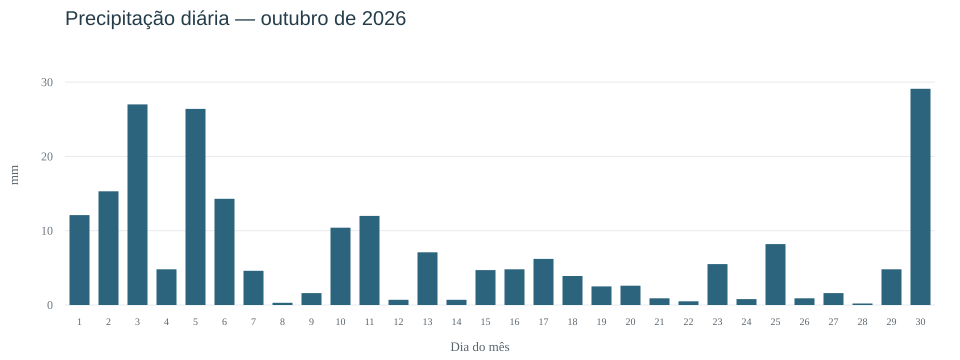

# Entendendo a chuva em Juiz de Fora

**Observatório Climático Local — material informativo para moradores de áreas suscetíveis a alagamentos**

## O que os dados mostram?
Entre **1º e 30 de outubro de 2026**, a API histórica Open-Meteo registrou, para uma célula de grade próxima ao ponto solicitado em Juiz de Fora:

- **214,5 mm de precipitação acumulada:** soma de toda a água precipitada por unidade de área no recorte (1 mm equivale a 1 litro por m² sobre superfície plana).
- **30 dias com precipitação superior a zero:** em 8 deles foi **menos de 1 mm**, uma quantidade muito pequena.
- **29,1 mm em 30 de outubro:** maior acumulado de um dia nesta amostra de 30 dias.

## O que esses números NÃO significam?
Não mostram que algum bairro alagou, não identificam ruas inundadas e não permitem prever se a sua casa vai alagar. Alagamentos dependem também de drenagem, relevo, ocupação e outras condições. Os dados são **históricos e modelados/em grade**, e esta análise considera **apenas 30 dias e um ponto**.

## Como usar estas informações com segurança?
Use a série para entender o significado de *mm de chuva* e comparar dias mais e menos chuvosos. Para decisões de segurança, acompanhe **avisos oficiais, Defesa Civil e orientações das autoridades locais**. Não use este observatório como sistema de alerta.

**Fontes:** [Open-Meteo Historical Weather API](https://open-meteo.com/en/docs/historical-weather-api) e [mapeamento de suscetibilidade da Prefeitura de Juiz de Fora](https://sisurb.pjf.mg.gov.br/server/rest/services/SISURB_dcivil/inundacao/MapServer/0).

**Nota sobre a coleta:** consulta feita em 20/11/2026, coordenadas pedidas (-21.764, -43.350); célula retornada (-21.75747, -43.384613).

*Material educativo preparado para possível apresentação. Não é registro de uma devolutiva já realizada.*
