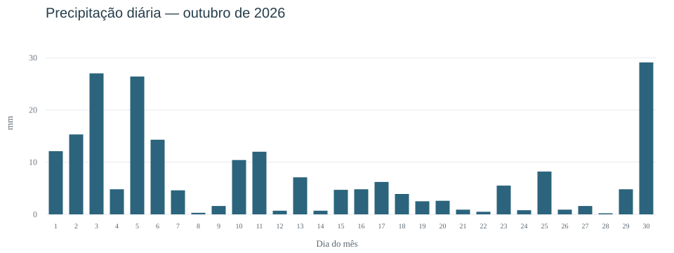
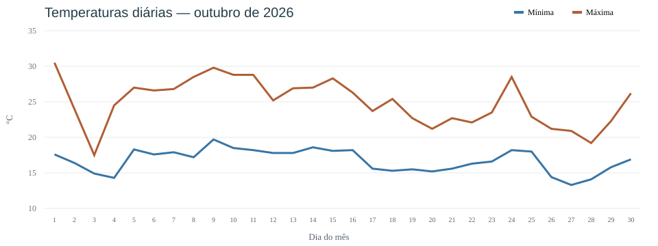

# AE1-2 — Relatório técnico e analítico (resultados verificados)

**Observatório Climático Local — Juiz de Fora/MG** · 01 a 30/10/2026

## 1. Contextualização, continuidade e beneficiários
A proposta busca facilitar a interpretação da precipitação histórica para moradores de áreas suscetíveis a alagamentos em Juiz de Fora. Isso **não** significa registrar alagamentos ocorridos ou emitir alertas. Como não foi disponibilizada a AE1 mencionada nos enunciados, esse recorte foi definido na elaboração do projeto e deverá ser validado pelo docente. As perguntas são: quanto choveu, em quantos dias choveu e qual foi o maior acumulado diário?

## 2. Fonte e coleta de dados
A coleta foi executada com **Python/Requests**, em **20/11/2026 às 19:47:24 UTC**, pela API histórica **Open-Meteo**, com latitude **-21.764**, longitude **-43.350**, início **2026-10-01**, fim **2026-10-30**, fuso **America/Sao_Paulo** e variáveis **temperature_2m_min**, **temperature_2m_max** e **precipitation_sum**. O JSON de resposta foi preservado em `dados/original_open_meteo.json` e a requisição em `dados/metadados_coleta.json`. Fonte: https://open-meteo.com/en/docs/historical-weather-api.

## 3. Tratamento e qualidade
O pandas converteu datas e valores numéricos, padronizou colunas, verificou 30 dias consecutivos, duplicidades, ausências, temperatura mínima não superior à máxima e precipitação não negativa. Ausências não são substituídas por zero. A tabela `clima_diario` usa `PRIMARY KEY(cidade,data)` e `UPSERT` para carga sem duplicação. O GitHub Actions executou o banco duas vezes, preservando 30 registros.

| Teste / evidência | Resultado |
| --- | ---: |
| Linhas no DuckDB | 30 |
| Datas distintas | 30 |
| Duplicidades | 0 |
| Ausências nas três variáveis | 0 |
| Seis testes automatizados | Aprovados |
| Execução repetida do banco | 30 linhas, sem novas duplicatas |

## 4. Consultas e indicadores (SQL)

| Pergunta | Consulta SQL resumida | KPI / unidade | Interpretação |
| --- | --- | --- | --- |
| Quanto choveu? | `SUM(precipitacao_mm)` | **214,5 mm** | Volume acumulado no ponto consultado |
| Em quantos dias houve chuva? | `COUNT(*) FILTER (WHERE precipitacao_mm > 0)` | **30 dias**, de 30 válidos | Inclui chuva fraca; **não** mede alagamentos |
| Qual a maior chuva diária? | `MAX(precipitacao_mm)` e data | **29,1 mm em 30/10/2026** | Maior valor diário do período, não ocorrência de enchente |

A média das mínimas diárias foi **16,73 °C**, e a média das máximas diárias **24,97 °C**. Do total, oito dias tiveram menos de 1 mm e três dias tiveram pelo menos 20 mm. Código integral em `sql/consultas.sql`.

## 5. Relevância extensionista e limites
O material permite à população comparar intensidade e frequência da chuva com informações publicadas por fontes públicas. **Não** permite dizer se, onde ou por que houve alagamento: o fenômeno também envolve drenagem, ocupação do solo, relevo e chuvas antecedentes. A série tem **30 dias** e **uma coordenada**, insuficientes para inferir padrões climáticos de longo prazo ou variação entre bairros. A Open-Meteo fornece dados históricos de grade/modelo, que não devem ser chamados de medições de estação local sem verificação. Análise histórica não é previsão meteorológica.

A validade técnica do recorte foi verificada. O efeito junto ao público-alvo e uma eventual devolutiva à comunidade **não foram medidos nem realizados**; necessitam etapa extensionista comprovada. Nenhum dado pessoal identificável da comunidade foi coletado ou publicado.

## 6. Evidências e execução
- [Execução real e qualidade](RESULTADOS_EXECUCAO.md)
- [CSV diário](../../../dados/clima_diario.csv)
- [JSON original](../../../dados/original_open_meteo.json)
- [Relatório de qualidade](../../../dados/qualidade.json)
- [Consulta SQL](../../../sql/consultas.sql)
- [Execução no GitHub Actions](https://github.com/ThalitaFelima/observatorio-climatico-juiz-de-fora/actions/runs/44805325913)
