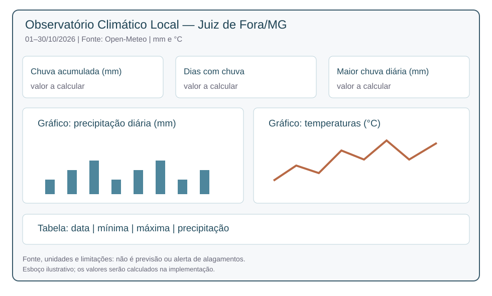

# Atividade de Estudo 2 — AE2-2
## Desenho técnico do Observatório Climático Local — versão 1

**Problema e público.** O projeto pretende facilitar o acesso e a compreensão de informações históricas de chuva e temperatura por moradores de Juiz de Fora, especialmente interessados em áreas suscetíveis a alagamentos. Os registros não serão usados para afirmar que houve inundações.

**Recorte definido na AE1:** Juiz de Fora/MG (latitude -21.764, longitude -43.350), de 01 a 30/10/2026, **30 dias consecutivos** e fuso `America/Sao_Paulo`. Fonte: API histórica Open-Meteo. Três variáveis: temperatura mínima diária (°C), temperatura máxima diária (°C) e precipitação diária (mm). O recorte e as perguntas planejadas foram mantidos.

## 1. Dicionário de dados — versão 1

A tabela principal prevista é `clima_diario`, com uma linha por localidade e data.

| Campo | Tipo DuckDB | Descrição / unidade | Origem | Regra de preenchimento e validação |
| --- | --- | --- | --- | --- |
| `cidade` | VARCHAR | Nome do município | Configuração: Juiz de Fora | Obrigatório; padronizado; parte da PK |
| `uf` | VARCHAR | Estado (sigla) | Configuração: MG | Obrigatório; duas letras |
| `latitude` | DOUBLE | Latitude, graus decimais | Configuração: -21.764 | Obrigatório; de -90 a 90 |
| `longitude` | DOUBLE | Longitude, graus decimais | Configuração: -43.350 | Obrigatório; de -180 a 180 |
| `data` | DATE | Data do registro diário | `daily.time` | Obrigatória; no recorte; parte da PK |
| `temperatura_min` | DOUBLE | Mínima diária (°C) | `daily.temperature_2m_min` | Aceita NULL; numérica; ≤ máxima quando ambas presentes |
| `temperatura_max` | DOUBLE | Máxima diária (°C) | `daily.temperature_2m_max` | Aceita NULL; numérica; ≥ mínima quando ambas presentes |
| `precipitacao_mm` | DOUBLE | Chuva diária acumulada (mm) | `daily.precipitation_sum` | Aceita NULL; numérica; ≥ 0 |

As coordenadas armazenadas serão as solicitadas à API. A localização da célula meteorológica de referência pode diferir das coordenadas informadas.

## 2. Modelo lógico e fluxo

**Modelo:** `clima_diario(cidade, uf, latitude, longitude, data, temperatura_min, temperatura_max, precipitacao_mm)`. **PK composta:** `(cidade, data)`, que impede registros repetidos para o mesmo município e dia. Serão obrigatórios cidade, uf, latitude, longitude e data; as medidas meteorológicas admitem valores ausentes. Há **uma tabela, sem FK ou relacionamentos** nesta versão. A carga será precedida de verificação de duplicidade e usará atualização por chave (UPSERT) em reexecuções.

**Fluxo previsto:** Open-Meteo → Python/Requests e JSON original preservado → pandas e validação → DuckDB → consultas SQL → painel Streamlit → comunicação com a comunidade. O GitHub reunirá os arquivos e acompanhará as tarefas.

## 3. Plano de qualidade — checagens antes da carga

| Checagem | Campo(s) | Regra ou teste | Ação em caso de falha |
| --- | --- | --- | --- |
| Estrutura da API | `daily.time` e três medidas | Listas obrigatórias presentes | Interromper e registrar a resposta |
| Alinhamento | Listas diárias | Todas com mesmo tamanho | Investigar antes de criar linhas |
| Campos obrigatórios | Cidade, UF, coordenadas, data | Nenhum NULL ou vazio | Corrigir configuração ou bloquear carga |
| Datas | `data` | Data válida entre 01 e 30/10/2026 | Identificar e rejeitar registro |
| Cobertura | `data` | Exatamente 30 dias consecutivos | Relatar lacunas e revisar a fonte |
| Duplicidade | `cidade`, `data` | Uma linha por combinação | Investigar e bloquear repetição |
| Tipos e unidades | Três variáveis | Numéricos em °C/mm, ou NULL | Registrar valor incompatível; não inventar correção |
| Temperaturas | Mínima, máxima | Mínima ≤ máxima quando presentes | Investigar e impedir carga inconsistente |
| Precipitação | `precipitacao_mm` | Maior ou igual a zero quando presente | Investigar e rejeitar valor negativo |
| Ausências | Três variáveis | Contar NULL por coluna | Preservar NULL e informar cobertura |
| Plausibilidade | Mínima, máxima | Sinalizar valores fora de -30 a 60 °C | Investigar fonte; faixa ampla de triagem, não limite climatológico local |

**Zero não equivale a ausência de informação:** 0 mm indica precipitação nula no registro disponível; NULL indica falta de dado. Não se preencherão ausências automaticamente.

## 4. Plano de análise e produto final

### 4.1. Perguntas, indicadores e visuais

| Pergunta | Campos necessários | Consulta/cálculo planejado | Indicador e unidade | Gráfico/tabela | Utilidade para moradores |
| --- | --- | --- | --- | --- | --- |
| Quanto choveu? | Cidade, data, precipitação | `SUM(precipitacao_mm)` no período | Chuva acumulada (mm) | Cartão e barras diárias | Comparar o volume acumulado entre dias |
| Em quantos dias choveu? | Cidade, data, precipitação | `COUNT(*) FILTER (WHERE precipitacao_mm > 0)` | Dias com chuva (dias) | Cartão e tabela | Entender a frequência de registros positivos |
| Qual foi o dia de maior chuva? | Cidade, data, precipitação | `MAX(precipitacao_mm)` e data associada | Máximo diário (mm e data) | Cartão e barras diárias | Identificar o maior valor no recorte |

**Critérios dos indicadores:**

1. **Acumulado:** soma em mm dos dias com valores disponíveis; `SUM` ignora NULL. Comparar `COUNT(precipitacao_mm)` com `COUNT(*)` para informar a cobertura. Não representa volume de alagamento.
2. **Dias com chuva:** contar datas cuja precipitação seja estritamente superior a zero; ignorar NULL e informar o número de dias com valor disponível. Pode incluir chuva fraca; não é contagem de alagamentos.
3. **Maior dia:** obter a maior precipitação não nula e sua data, adotando desempate cronológico ou informando empates. Se não houver dados válidos, exibir “sem dados”, nunca 0 mm fictício. O valor descreve apenas o extremo do período.

**Dois gráficos planejados:** barras para a precipitação diária (mm) e linhas para as temperaturas mínima e máxima ao longo das datas (°C). **Tabela consultável:** data, cidade e três medidas meteorológicas. Os dados serão ordenados cronologicamente, com fonte e unidades explícitas. Poderá ser oferecido filtro de dias para recalcular a seleção. **Não se antecipam resultados numéricos nesta fase de planejamento.**

### 4.2. Wireframe em Streamlit

A disposição prevista contém título, localidade e período, três cartões de KPI, dois gráficos, tabela de registros e espaço para fonte, unidades, explicações e limitações.

### 4.3. Comunicação extensionista

O painel deverá ajudar moradores a consultar registros históricos em linguagem simples, com explicação de mm, °C, datas, totais e limites. Na apresentação ao público, serão colhidas dúvidas e sugestões de clareza, sem exposição de nomes, contatos ou imagens pessoais sem autorização. A fonte representa dados meteorológicos históricos em grade, não necessariamente medições diretas de estação local. Não serão emitidas previsões, alertas ou conclusões sobre alagamentos baseadas apenas nesses indicadores; informações de risco dependerão das fontes oficiais.

## 5. GitHub — documentação e tarefas

O repositório contém o desenho e os diagramas em `docs/escopo-1/AE2-2/`, o README e as pastas `src/`, `dados/` e `sql/`. O documento descreve a **solução planejada**, embora o repositório também reúna implementações de etapas posteriores.

As **sete issues** da implementação possuem descrição e condição de conclusão: [#1 coleta](https://github.com/ThalitaFelima/observatorio-climatico-juiz-de-fora/issues/1), [#2 JSON original](https://github.com/ThalitaFelima/observatorio-climatico-juiz-de-fora/issues/2), [#3 pandas e qualidade](https://github.com/ThalitaFelima/observatorio-climatico-juiz-de-fora/issues/3), [#4 DuckDB](https://github.com/ThalitaFelima/observatorio-climatico-juiz-de-fora/issues/4), [#5 SQL e KPIs](https://github.com/ThalitaFelima/observatorio-climatico-juiz-de-fora/issues/5), [#6 Streamlit](https://github.com/ThalitaFelima/observatorio-climatico-juiz-de-fora/issues/6) e [#7 documentação e comunicação](https://github.com/ThalitaFelima/observatorio-climatico-juiz-de-fora/issues/7).

**Fonte:** [Open-Meteo — API histórica](https://open-meteo.com/en/docs/historical-weather-api).
