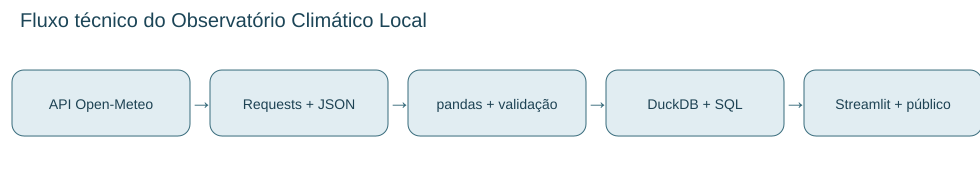

# AE2-2 — Desenho técnico da solução

**Projeto:** Observatório Climático Local — Juiz de Fora/MG. **Público-alvo:** moradores de áreas suscetíveis a alagamentos. **Objetivo:** facilitar o acesso a informações históricas de chuva e temperatura, com indicadores claros e consulta aos registros.

## Recorte
Coordenadas de referência: latitude -21.764, longitude -43.350; período de 01 a 30/10/2026 (30 dias); fuso America/Sao_Paulo; API histórica Open-Meteo. Variáveis: mínima diária (°C), máxima diária (°C), precipitação diária (mm).

## Dicionário de dados — tabela `clima_diario`

| Campo | Tipo DuckDB | Origem e descrição | Regra |
| --- | --- | --- | --- |
| cidade | VARCHAR | Configuração; município | NOT NULL; parte da PK |
| uf | VARCHAR | Configuração; estado | NOT NULL |
| latitude | DOUBLE | Configuração; latitude decimal | NOT NULL; [-90,90] |
| longitude | DOUBLE | Configuração; longitude decimal | NOT NULL; [-180,180] |
| data | DATE | Open-Meteo daily.time | NOT NULL, no intervalo; parte da PK |
| temperatura_min | DOUBLE | daily.temperature_2m_min; °C | Nullable; numérica, <= máxima |
| temperatura_max | DOUBLE | daily.temperature_2m_max; °C | Nullable; numérica, >= mínima |
| precipitacao_mm | DOUBLE | daily.precipitation_sum; mm | Nullable; numérica, >= 0 |

## Modelo lógico
`clima_diario(cidade PK, data PK, uf, latitude, longitude, temperatura_min, temperatura_max, precipitacao_mm)`. Chave composta (cidade, data), uma única tabela, sem chave estrangeira nesta versão. Reexecução de carga com UPSERT para evitar duplicação.

**Fluxo:** Open-Meteo → Requests/JSON original → pandas/validação → DuckDB → SQL/KPIs → Streamlit → comunicação para público leigo.

## Plano de qualidade

| Checagem | Regra | Tratamento |
| --- | --- | --- |
| Presença de campos | campos da API obrigatórios | Rejeitar estrutura inválida |
| Tamanho das listas | tamanhos iguais | Interromper e revisar resposta |
| Datas | conversíveis para DATE e dentro do recorte | Rejeitar |
| Cobertura | 30 dias consecutivos | Interromper carga |
| Duplicação | 1 linha por cidade e data | Rejeitar dados; PK/UPSERT na carga |
| Tipos | variáveis numéricas ou NULL | Rejeitar valor não numérico |
| Mínima e máxima | mínima <= máxima quando presentes | Rejeitar inconsistência |
| Precipitação | >=0 quando presente | Rejeitar negativo |
| Ausências | contar NULL e distinguir de zero | Preservar NULL e informar cobertura |
| Faixas de triagem | temperatura entre -30 e 60 °C | Investigar; faixa de triagem, não limite físico regional |

## Perguntas, indicadores e visuais
1. Quanto choveu no período? **Soma de precipitação em mm**, ignorando NULL; gráfico de barras diário.
2. Em quantos dias houve chuva? **Contagem de registros com precipitação >0 mm**, em dias; tabela e gráfico.
3. Qual o dia de maior precipitação? **Máximo diário em mm e data**, desconsiderando NULL; gráfico de barras.

Análise adicional: linha de mínimas/máximas por dia (°C). Mostrar fonte, unidade, datas, registros válidos, limitações e tabela consultável.

## Wireframe do painel
```text
OBSERVATÓRIO CLIMÁTICO — JUIZ DE FORA
01–30/10/2026 | Open-Meteo | Coordenadas de referência
[Chuva acumulada (mm)] [Dias com chuva] [Maior chuva diária (mm)]
[Gráfico: precipitação por dia]
[Gráfico: temperatura mínima e máxima por dia]
[Tabela de dados]
[Fonte, unidades, ressalvas sobre limites e Defesa Civil]
```

## Comunicação extensionista
Explicar os indicadores em linguagem acessível, sem relacionar automaticamente chuva de um ponto a alagamento de um bairro. Comparar, quando apropriado, com os mapas oficiais de suscetibilidade, **sem inferir episódios de inundação**. Não recolher dados pessoais sem base e cuidados pertinentes. A devolutiva incluiu conversas com cinco pessoas entre 17 e 20 de novembro de 2026. O retorno destacou a importância do projeto e a necessidade de tornar as informações mais fáceis de acessar.

## Aplicação do planejamento
O planejamento orientou a coleta de 30 dias de dados, a organização do banco, as consultas SQL e a construção do painel Streamlit. As verificações e os resultados encontram-se documentados nas demais etapas do projeto.

## Diagramas anexados




As imagens mostram o percurso dos dados até a visualização e a disposição dos três KPIs, dois gráficos, tabela, fonte e limitações.

