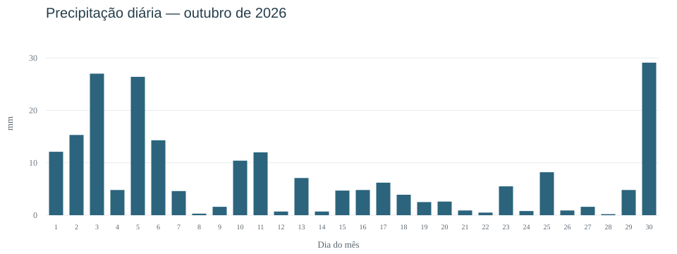
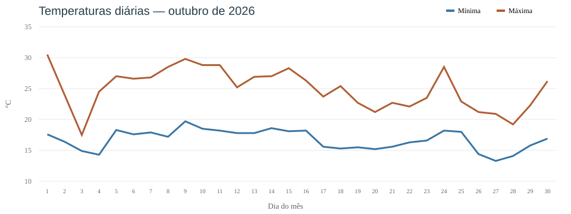
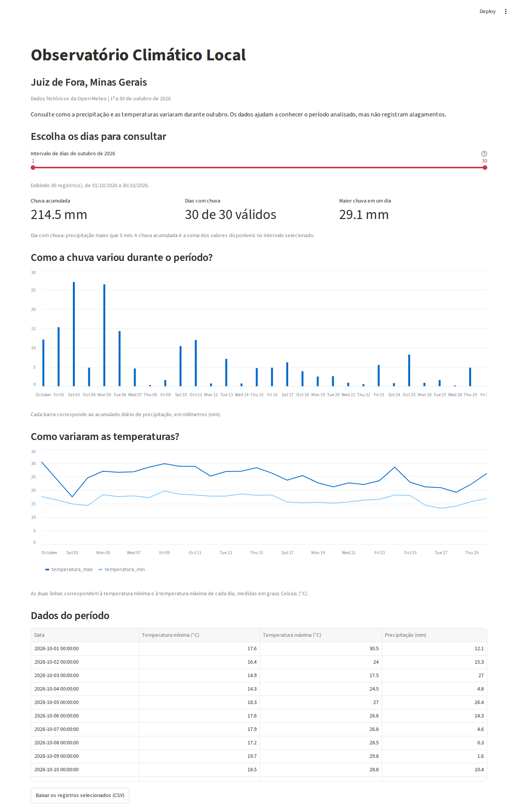

# Relatório Final — Observatório Climático Local

**Juiz de Fora/MG | Projeto Integrador Extensionista 2**

## 1. Contextualização

O Observatório Climático Local foi desenvolvido para organizar e apresentar dados históricos de chuva e temperatura de Juiz de Fora, com atenção especial à população de áreas sujeitas a alagamentos. A proposta surgiu da importância de tornar informações meteorológicas mais acessíveis e fáceis de compreender.

O estudo utiliza 30 dias consecutivos, de 1º a 30 de outubro de 2026, em Juiz de Fora/MG (coordenadas solicitadas: latitude -21.764, longitude -43.350; fuso America/Sao_Paulo), e três variáveis: temperatura mínima (°C), temperatura máxima (°C) e precipitação diária (mm). A análise descreve condições meteorológicas do período e não tem a finalidade de prever eventos futuros.

## 2. Desenvolvimento da solução

A coleta registrada nos metadados ocorreu em 20/11/2026 às 20h19min53s UTC, por meio da API histórica Open-Meteo, com Python e Requests. A resposta original foi preservada em JSON. Em seguida, os dados foram organizados e verificados com pandas, incluindo conferência de datas, tipos numéricos, valores ausentes, registros repetidos e coerência entre as temperaturas.

Após a validação, os registros foram armazenados em um banco DuckDB, na tabela `clima_diario`, com chave primária composta `(cidade, data)` e carga por UPSERT, evitando linhas duplicadas em novas execuções. As consultas SQL produziram os indicadores apresentados no painel Streamlit, composto por três métricas, dois gráficos e uma tabela de consulta.

O GitHub reúne os códigos, o banco de dados, os documentos e o histórico das alterações. Os registros publicados e os testes automatizados confirmam 30 datas distintas, sem duplicações nem valores ausentes nas três variáveis. A resposta JSON original foi preservada, assim como os parâmetros da requisição. Ausências, caso ocorram em coletas futuras, não serão preenchidas automaticamente com zero.

| Verificação da qualidade | Resultado |
| --- | ---: |
| Cobertura temporal | 30 de 30 dias |
| Duplicidades por cidade/data | 0 |
| Valores ausentes (mínima, máxima, precipitação) | 0, 0, 0 |
| Regras de datas, tipos e consistência física | Aprovadas |

A estrutura dos dados, as regras de qualidade e o modelo lógico estão documentados no planejamento da AE2-2; o procedimento de coleta, a carga e as consultas completas podem ser reproduzidos pelos comandos do README.

## 3. Resultados e interpretação

| Indicador | Resultado |
| --- | ---: |
| Precipitação acumulada no período | **214,5 mm** |
| Dias com precipitação superior a zero | **30 dias** |
| Maior precipitação diária | **29,1 mm, em 30/10/2026** |
| Média das temperaturas mínimas diárias | **16,73 °C** |
| Média das temperaturas máximas diárias | **24,97 °C** |

Apesar de haver precipitação registrada nos 30 dias, oito deles tiveram menos de 1 mm. Isso demonstra a importância de observar não apenas a quantidade de dias com chuva, mas também a intensidade dos acumulados.

## 4. Painel de visualização

O painel foi desenvolvido em Streamlit para reunir os indicadores e os registros em uma única interface. A visualização permite observar a distribuição da chuva ao longo do mês, comparar as temperaturas diárias e consultar a tabela de dados. Também é possível selecionar um intervalo de dias e baixar os registros correspondentes em CSV, facilitando a consulta das informações pelo público. A execução e a renderização foram verificadas por testes automatizados, com captura de tela do aplicativo executado localmente, disponível no repositório. Isso comprova o funcionamento do painel no ambiente testado, **não** a existência de hospedagem pública.

## 5. Devolutiva extensionista

Entre 17 e 20 de novembro de 2026, conversei com cinco pessoas para apresentar a API, a estrutura do banco de dados e os benefícios esperados do observatório. A atividade consistiu na apresentação da proposta e dos seus componentes, **não** em um teste formal de usabilidade de um site publicado. A recepção foi positiva e os participantes consideraram importante reunir e preservar essas informações. Entretanto, também observaram que o acesso difícil aos registros pode limitar sua utilidade para a população.

Essa contribuição mostrou que uma solução de dados não deve ser pensada apenas do ponto de vista técnico. As informações precisam estar organizadas e ser apresentadas em linguagem clara, de modo que possam ser consultadas por pessoas que não têm familiaridade com bancos de dados ou indicadores meteorológicos.

A atividade foi registrada de forma descritiva, sem identificação pessoal dos participantes. Mais detalhes constam no [registro da devolutiva](../devolutiva/RELATO_REAL.md).

## 6. Limitações e possibilidades de continuidade

Os dados analisados representam uma área de referência do município e não permitem determinar se houve alagamento em determinada rua ou bairro. O período de 30 dias também é insuficiente para estabelecer tendências climáticas de longo prazo. Como os dados históricos da Open-Meteo são apresentados em grade, sua posição de referência deve ser considerada na interpretação.

Como continuidade, seria interessante ampliar a série histórica, tornar o painel mais simples de acessar e, futuramente, relacionar os indicadores a informações oficiais sobre suscetibilidade a inundações, respeitando as diferenças entre chuvas registradas e ocorrências de alagamentos.

## 7. Avaliação dos critérios de sucesso

| Critério do projeto | Avaliação |
| --- | --- |
| Um município, 30 dias consecutivos e até três variáveis | Atendido: Juiz de Fora, 01–30/10/2026, três medidas |
| Coleta rastreável e base consistente | Atendido: JSON e metadados disponíveis; 30 datas sem duplicações |
| Três perguntas com indicadores verificáveis | Atendido: precipitação total, dias com chuva e maior valor diário, com consultas SQL |
| Painel com três métricas, dois gráficos e tabela | Atendido no aplicativo Streamlit, validado em execução local |
| Comunicação inicial com o público beneficiário | Realizada com cinco pessoas, com retorno qualitativo registrado |
| Acesso público e avaliação estruturada de usabilidade | Ainda não verificados; possibilidades de continuidade |

## 8. Considerações finais

O desenvolvimento do Observatório Climático Local permitiu aplicar diferentes etapas de um projeto de dados, desde a coleta até a comunicação dos resultados. A base foi organizada, os indicadores foram calculados e o painel foi colocado em funcionamento. A devolutiva reforçou que a disponibilização acessível das informações é tão importante quanto a sua organização técnica.

## Referências

- [Open-Meteo — API histórica](https://open-meteo.com/en/docs/historical-weather-api)
- [Prefeitura de Juiz de Fora — mapa de suscetibilidade a inundações](https://sisurb.pjf.mg.gov.br/server/rest/services/SISURB_dcivil/inundacao/MapServer/0)
- [Registros da execução do projeto](../escopo-1/AE1-2/RESULTADOS_EXECUCAO.md)
- [Plano técnico AE2-2](../escopo-1/AE2-2/PLANEJAMENTO.md)
- [Código e consultas SQL](../../sql/consultas.sql)
- [Evidência do painel Streamlit](../evidencias/VALIDACAO.md)
